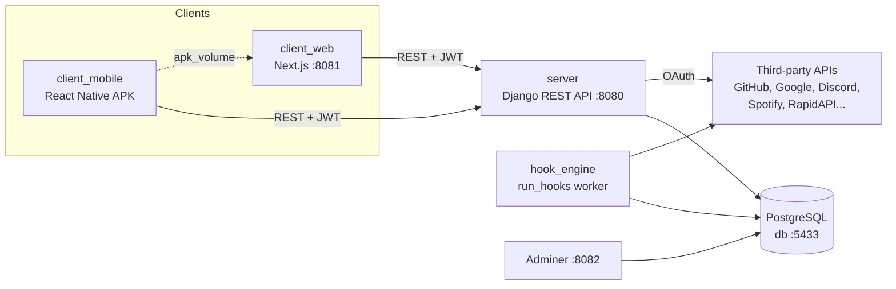

🇬🇧 [English](README.md) | 🇫🇷 Français

# AREA — Plateforme d'automatisation Action-Réaction

> Une plateforme auto-hébergée de type IFTTT/Zapier : connectez des services tiers et déclenchez une **REAction** dès qu'une **Action** se produit. Une API REST Django, un client web Next.js, un client mobile React Native.


<!-- TODO: add screenshot -->

## À propos

AREA permet à un utilisateur de s'abonner à des services (GitHub, Gmail, Discord, Spotify, Telegram, minuteurs, API publiques, etc.) et de les relier entre eux sous forme d'**AREA** : « quand *cette action* se produit sur le service A, exécuter *cette réaction* sur le service B ». Par exemple : *chaque jour à 08:00 → envoyer un message Discord*, ou *nouvelle issue GitHub → envoyer un e-mail*.

Le projet a été réalisé pour le sujet G-DEV-500 « AREA » (voir `G-DEV-500_AREA.pdf`). Principe de conception central : **les clients ne contiennent aucune logique métier**. Les applications web et mobile sont de simples interfaces au-dessus de l'API REST ; l'intégration des services, la planification et l'exécution se font côté serveur.

## Fonctionnalités principales

- **Gestion de compte** : inscription, connexion/rafraîchissement/déconnexion JWT, réinitialisation du mot de passe par e-mail, changement de mot de passe, profil et avatar, suppression du compte, liste des sessions actives, endpoints de configuration/vérification 2FA, préférences de notification.
- **Liaison de services via OAuth2** : flux OAuth GitHub, Spotify et Google (Gmail) ; les jetons tiers sont stockés chiffrés (Fernet) en base de données.
- **Gestion des AREA** : création, liste, modification, suppression ; journaux d'exécution par AREA ; statistiques du tableau de bord.
- **Moteur de hooks** : un worker séparé en arrière-plan (`python manage.py run_hooks`) interroge chaque AREA active à intervalle configurable et exécute la réaction correspondante.
- **Providers en mode plugin** : chaque service est une classe provider enregistrée dans un `ProviderRegistry` ; les vérificateurs d'actions et exécuteurs de réactions sont enregistrés via les décorateurs `@register_action` / `@register_reaction`.
- **`GET /about.json`** : liste exploitable par machine des services, actions et réactions, au format exigé par le sujet.
- **APK mobile servie par le client web** : le conteneur mobile construit un APK Android dans un volume Docker partagé, et le client web le sert sur `/client.apk`.
- **Limitation de débit** avec le throttling DRF (quotas anonymes, authentifiés et spécifiques à la connexion).

### Services, actions et réactions

Ces handlers sont enregistrés dans le moteur de hooks (`server/automation/hooks/`) :

| Service | Actions (déclencheurs) | Réactions |
|---------|------------------------|-----------|
| Timer | `every_minute`, `every_hour`, `every_day`, `cron_schedule` | — |
| System | `timer` | `log` |
| GitHub | `new_commit`, `new_issue`, `new_pull_request` | `create_issue` |
| Gmail | `new_email` | `send_email` |
| Discord | `new_message` | `send_message` |
| Telegram | `new_message` | `send_message` |
| Spotify | `new_saved_track` | `add_to_playlist` |
| Twitter | `new_tweet` | `post_tweet` |
| Instagram | `new_post` | — |
| WeatherAPI | `temperature_change` | — |
| AliExpress | `price_change` | — |
| Anime | `new_anime_airing` | `get_anime_details` |
| Image Gen | — | `generate_image` |
| Games | — | `get_game_news` |
| Job Search | — | `get_job_details` |
| Yahoo Finance | — | `get_market_news` |
| PDF Converter | — | `pdf_to_text` |
| Contact Crawler | — | `scrape_contacts` |
| Vehicle | — | `detect_license_plate` |
| Spotify DL | — | `download_song` |

Des définitions de providers existent aussi pour Horoscope, Books, Translate, Sport et AI Detection (`server/automation/providers/`), sans handlers de hooks pour l'instant. Plusieurs services tiers reposent sur des clés [RapidAPI](https://rapidapi.com/) (voir [Configuration](#configuration)). La liste à jour d'un serveur en marche est toujours disponible sur `GET /about.json`.

## Stack technique

| Couche | Technologies |
|--------|--------------|
| API backend | Python, Django, Django REST Framework, SimpleJWT, django-allauth, django-cors-headers, django-environ, cryptography (Fernet), requests |
| Moteur de hooks | Commande de gestion Django (`run_hooks`) exécutée dans son propre conteneur |
| Base de données | PostgreSQL 15 (Adminer pour l'inspection) |
| Client web | Next.js 16 (App Router), React 19, TypeScript, Tailwind CSS 4, Framer Motion, Radix UI, lucide-react |
| Client mobile | React Native 0.82, React Navigation, AsyncStorage, react-native-svg ; Vite + react-native-web pour un aperçu web |
| Outillage | Docker Compose, ESLint, Jest (mobile), test runner Django (serveur) |

### Choix techniques notables

- **Processus worker séparé** pour l'automatisation : le conteneur de l'API n'exécute jamais d'AREA ; le service `hook_engine` exécute la même base de code Django avec `run_hooks --interval N`, ce qui évite que les appels lents aux services tiers dégradent la latence de l'API.
- **Registre + décorateurs** plutôt que des `if/else` codés en dur par service : ajouter un service revient à ajouter un fichier provider et des fichiers de handlers, puis à les synchroniser en base avec `init_services` / `sync_providers`.
- **Jetons OAuth chiffrés** : les jetons des services liés sont chiffrés au repos avec une clé Fernet dérivée du `SECRET_KEY` Django.
- **URL du backend configurable sur mobile** : l'application stocke l'URL de l'API dans AsyncStorage et peut la tester via `/about.json` depuis l'écran Paramètres (voir `mobile/SERVER_CONFIG.md`).

## Architecture



| Service Docker | Port hôte | Rôle |
|----------------|-----------|------|
| `server` | 8080 | Backend Django/DRF |
| `hook_engine` | — | Exécuteur des AREA en arrière-plan |
| `client_web` | 8081 | Frontend Next.js (serveur de dev), sert aussi l'APK |
| `client_mobile` | — | Construit l'APK Android dans `apk_volume` |
| `db` | 5433 | PostgreSQL 15 |
| `adminer` | 8082 | Interface de la base de données |

## Démarrage

### Prérequis

- Docker et Docker Compose
- 5 Go+ d'espace disque libre pour le build Android complet (compter 15 à 20 minutes)
- Pour une exécution hors Docker : Python 3.10+ (le projet cible Django 5.2), Node.js 20+

> **Remarque :** `docker-compose.yml` construit les images `server` et `hook_engine` à partir de `./server`, mais le dépôt ne contient actuellement ni `server/Dockerfile` ni fichier de dépendances Python (`requirements.txt`). Il faut les ajouter avant que `docker-compose build` puisse construire ces deux services. Les paquets Python importés par le code sont : `Django`, `djangorestframework`, `djangorestframework-simplejwt`, `django-allauth`, `django-cors-headers`, `django-environ`, `cryptography`, `requests`, `user-agents`.

### Configuration

Le serveur lit ses variables d'environnement depuis `server/.env` (via `django-environ`) ; ce fichier est ignoré par git et également chargé par le conteneur `hook_engine`. Aucun `.env.example` n'est fourni : créez le fichier vous-même.

**Serveur (`server/.env`)**

| Variable | Obligatoire | Description |
|----------|-------------|-------------|
| `DATABASE_URL` | Oui | URL de connexion PostgreSQL. Pour le conteneur local `db` : `postgresql://area_user:area_password@db:5432/area_db` (depuis l'hôte : port `5433`) |
| `EMAIL_BACKEND` | Non | Par défaut, backend console (les e-mails sont affichés dans les logs) |
| `EMAIL_HOST`, `EMAIL_PORT`, `EMAIL_USE_TLS`, `EMAIL_HOST_USER`, `EMAIL_HOST_PASSWORD`, `DEFAULT_FROM_EMAIL` | Pour l'envoi réel | Paramètres SMTP utilisés pour les e-mails de réinitialisation du mot de passe |
| `GOOGLE_CLIENT_ID`, `GOOGLE_CLIENT_SECRET`, `GOOGLE_REDIRECT_URI` | Pour Gmail | Application OAuth Google (redirection par défaut : `http://localhost:8081/`) |
| `GITHUB_CLIENT_ID`, `GITHUB_CLIENT_SECRET` | Pour GitHub | Application OAuth GitHub |
| `SPOTIFY_CLIENT_ID`, `SPOTIFY_CLIENT_SECRET` | Pour Spotify | Application OAuth Spotify |
| `DISCORD_BOT_TOKEN` | Pour Discord | Jeton du bot utilisé pour lire/envoyer des messages |
| `TELEGRAM_BOT_TOKEN` | Pour Telegram | Jeton du bot |
| `<SERVICE>_RAPIDAPI_KEY` | Selon le service | Clés RapidAPI : `ALIEXPRESS_`, `ANIME_`, `BOOKS_`, `CONTACT_CRAWLER_`, `GAMES_`, `HOROSCOPE_`, `IMAGE_GEN_`, `INSTAGRAM_`, `JOB_SEARCH_`, `NETFLIX_`, `PDF_CONVERTER_`, `SPORT_`, `SPOTIFY_`, `TRANSLATE_`, `VEHICLE_`, `YAHOO_FINANCE_`, `YOUTUBE_`, `AI_DETECTION_` (voir `API_KEYS.md`) |
| `HOOK_INTERVAL` | Non | Intervalle d'interrogation du moteur de hooks en secondes (`15` par défaut, utilisé par `docker-compose.yml`) |

**Client web (`web/.env.local`)**

| Variable | Défaut | Description |
|----------|--------|-------------|
| `NEXT_PUBLIC_API_URL` | `http://localhost:8080` | URL du backend utilisée par la plupart des pages |
| `NEXT_PUBLIC_API_BASE` | `http://localhost:8080` | URL du backend utilisée par `web/lib/api.ts` |
| `NEXT_PUBLIC_GOOGLE_CLIENT_ID`, `NEXT_PUBLIC_GOOGLE_REDIRECT_URI` | — | OAuth Google côté client web |

> `docker-compose.yml` définit actuellement `DATABASE_URL` et les identifiants SMTP directement dans les services `server` et `hook_engine`. Remplacez-les par vos propres valeurs (ou supprimez-les pour que `server/.env` soit utilisé) avant de lancer la stack.

### Lancer avec Docker

```bash
docker-compose build
docker-compose up -d
```

| Point d'accès | URL |
|---------------|-----|
| API backend | http://localhost:8080/ |
| Frontend web | http://localhost:8081/ |
| APK Android | http://localhost:8081/client.apk |
| Adminer | http://localhost:8082/ |
| PostgreSQL | `localhost:5433` |

Commandes utiles :

```bash
docker-compose logs -f server
docker-compose logs -f client_mobile
docker-compose restart server
docker-compose down
```

Si l'APK n'apparaît pas dans le volume partagé, `./copy-apk-to-web.sh` la copie du conteneur `area_mobile` vers `area_web`.

### Lancer sans Docker

**Serveur**

```bash
cd server
python manage.py migrate
python manage.py init_services          # charge services/actions/réactions depuis les providers
python manage.py runserver 0.0.0.0:8080
```

**Moteur de hooks** (autre terminal)

```bash
cd server
python manage.py run_hooks --interval 15   # ajouter --oneshot pour un seul passage
```

**Client web**

```bash
cd web
npm install
npm run dev
```

**Client mobile**

```bash
cd mobile
npm install
npm start          # bundler Metro
npm run android    # ou : npm run ios / npm run web (aperçu Vite)
```

Sur un émulateur Android, l'URL du backend par défaut est `http://10.0.2.2:8080` ; modifiez-la via **Menu → Paramètres** dans l'application.

## Utilisation

1. Inscrivez-vous et connectez-vous sur le client web (`http://localhost:8081`) ou mobile.
2. Ouvrez **Services**, abonnez-vous à un service et terminez son flux OAuth si nécessaire (GitHub, Spotify, Google).
3. Allez dans **Create**, choisissez une action et une réaction, renseignez leurs paramètres et enregistrez l'AREA.
4. Le moteur de hooks l'évalue à chaque cycle ; consultez les résultats dans **Logs** ou sur le tableau de bord.

Exemples d'appels API :

```bash
# Register / log in
curl -X POST http://localhost:8080/auth/register/ \
  -H "Content-Type: application/json" \
  -d '{"email":"user@example.com","password":"Aa1!aaaa"}'

curl -X POST http://localhost:8080/auth/login/ \
  -H "Content-Type: application/json" \
  -d '{"email":"user@example.com","password":"Aa1!aaaa"}'

# Services catalogue
curl http://localhost:8080/about.json

# List your AREAs
curl http://localhost:8080/areas/ -H "Authorization: Bearer ACCESS_TOKEN"
```

Principaux endpoints :

| Domaine | Endpoints |
|---------|-----------|
| Authentification | `POST /auth/register/`, `POST /auth/login/`, `POST /auth/refresh/`, `POST /auth/logout/`, `GET /auth/me/`, `POST /auth/password/reset/`, `POST /auth/password/reset/confirm/`, `POST /auth/password/change/` |
| Comptes OAuth | `POST /auth/oauth/link/`, `GET /auth/oauth/accounts/`, `DELETE /auth/oauth/accounts/{id}/`, `GET /github/connect/`, `GET /spotify/connect/` |
| Services | `GET /services/`, `GET /services/subscriptions/`, `GET /services/{id}/actions/`, `GET /services/{id}/reactions/`, `POST /services/{id}/subscribe/`, `DELETE /services/{id}/unsubscribe/` |
| AREA | `GET/POST /areas/`, `GET/PATCH/DELETE /areas/{id}/`, `GET /areas/logs/`, `GET /stats/` |
| Métadonnées | `GET /about.json` |

Voir `server/accounts/urls.py` et `server/automation/urls.py` pour la liste complète, ainsi que `API_ENDPOINTS.md` / `COMMANDS.md` pour d'autres exemples.

## Structure du projet

```
area/
├── docker-compose.yml        # server, hook_engine, client_web, client_mobile, db, adminer
├── server/                   # projet Django
│   ├── area_server/          # settings, URLs racines
│   ├── accounts/             # utilisateurs, auth JWT, sessions, comptes OAuth, 2FA
│   └── automation/
│       ├── providers/        # une classe provider par service + registre
│       ├── hooks/
│       │   ├── actions/      # vérificateurs d'actions (@register_action)
│       │   └── reactions/    # exécuteurs de réactions (@register_reaction)
│       ├── services/         # clients d'API tierces (RapidAPI, etc.)
│       ├── management/commands/  # run_hooks, init_services, sync_providers, prune_services
│       └── fixtures/
├── web/                      # client Next.js (app/ : dashboard, areas, create, services, logs, settings...)
├── mobile/                   # client React Native (src/screens, src/api, src/config) + build-apk.sh
├── scripts/subscribe_all.sh  # abonne un utilisateur à tous les services via l'API
├── API_ENDPOINTS.md · API_KEYS.md · COMMANDS.md · HOWTOCONTRIBUTE.md
└── G-DEV-500_AREA.pdf        # sujet du projet
```

## Tests

```bash
# Serveur (accounts, services, AREA)
cd server
python manage.py test accounts automation -v 2

# Mobile
cd mobile
npm test

# Lint web
cd web
npm run lint
```

## Contribuer

Voir [`HOWTOCONTRIBUTE.md`](HOWTOCONTRIBUTE.md) pour ajouter un nouveau service, une action ou une réaction (provider, handlers, `about.json`, tests). La configuration du backend côté mobile est documentée dans [`mobile/SERVER_CONFIG.md`](mobile/SERVER_CONFIG.md). `CICD.md` décrit un pipeline GitHub Actions prévu ; les fichiers de workflow ne sont pas inclus dans ce dépôt.

## Auteurs

Maintenu par [andysags](https://github.com/andysags).
