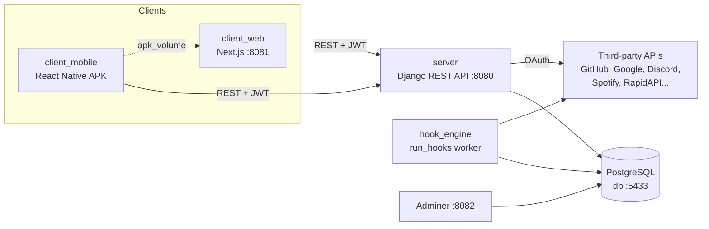

🇬🇧 English | 🇫🇷 [Français](README.fr.md)

# AREA — Action-Reaction Automation Platform

> A self-hosted IFTTT/Zapier-style platform: connect third-party services and trigger a **REAction** whenever an **Action** happens. One Django REST API, one Next.js web client, one React Native mobile client.


<!-- TODO: add screenshot -->

## About

AREA lets a user subscribe to services (GitHub, Gmail, Discord, Spotify, Telegram, timers, public APIs, and more) and wire them together into **AREAs**: "when *this action* happens on service A, run *this reaction* on service B". For example: *every day at 08:00 → send a Discord message*, or *new GitHub issue → send an email*.

The project was built for the G-DEV-500 "AREA" subject (see `G-DEV-500_AREA.pdf`). A core design rule: **the clients contain no business logic**. The web and mobile apps are thin UIs over the REST API; all service integration, scheduling and execution happen on the server.

## Key features

- **Account management**: registration, JWT login/refresh/logout, password reset by email, password change, profile and avatar, account deletion, active session list, 2FA setup/verification endpoints, notification preferences.
- **Service linking with OAuth2**: GitHub, Spotify and Google (Gmail) OAuth flows; third-party tokens are stored encrypted (Fernet) in the database.
- **AREA management**: create, list, edit, delete AREAs; per-AREA execution logs; dashboard statistics.
- **Hook engine**: a separate background worker (`python manage.py run_hooks`) polls every active AREA on a configurable interval and runs the matching reaction.
- **Plugin-style providers**: each service is a provider class registered in a `ProviderRegistry`; action checkers and reaction executors are registered with `@register_action` / `@register_reaction` decorators.
- **`GET /about.json`**: machine-readable list of services, actions and reactions, in the format required by the subject.
- **Mobile APK served by the web client**: the mobile container builds an Android APK into a shared Docker volume, and the web client serves it at `/client.apk`.
- **Rate limiting** with DRF throttling (anonymous, authenticated and login-specific rates).

### Services, actions and reactions

These handlers are registered in the hook engine (`server/automation/hooks/`):

| Service | Actions (triggers) | Reactions |
|---------|-------------------|-----------|
| Timer | `every_minute`, `every_hour`, `every_day`, `cron_schedule` | — |
| System | `timer` | `log` |
| GitHub | `new_commit`, `new_issue`, `new_pull_request` | `create_issue` |
| Gmail | `new_email` | `send_email` |
| Discord | `new_message` | `send_message` |
| Telegram | `new_message` | `send_message` |
| Spotify | `new_saved_track` | `add_to_playlist` |
| Twitter | `new_tweet` | `post_tweet` |
| Instagram | `new_post` | — |
| WeatherAPI | `temperature_change` | — |
| AliExpress | `price_change` | — |
| Anime | `new_anime_airing` | `get_anime_details` |
| Image Gen | — | `generate_image` |
| Games | — | `get_game_news` |
| Job Search | — | `get_job_details` |
| Yahoo Finance | — | `get_market_news` |
| PDF Converter | — | `pdf_to_text` |
| Contact Crawler | — | `scrape_contacts` |
| Vehicle | — | `detect_license_plate` |
| Spotify DL | — | `download_song` |

Provider definitions also exist for Horoscope, Books, Translate, Sport and AI Detection (`server/automation/providers/`), without hook handlers yet. Several third-party services rely on [RapidAPI](https://rapidapi.com/) keys (see [Configuration](#configuration)). The live list for a running server is always available at `GET /about.json`.

## Tech stack

| Layer | Technologies |
|-------|--------------|
| Backend API | Python, Django, Django REST Framework, SimpleJWT, django-allauth, django-cors-headers, django-environ, cryptography (Fernet), requests |
| Hook engine | Django management command (`run_hooks`) running in its own container |
| Database | PostgreSQL 15 (Adminer for inspection) |
| Web client | Next.js 16 (App Router), React 19, TypeScript, Tailwind CSS 4, Framer Motion, Radix UI, lucide-react |
| Mobile client | React Native 0.82, React Navigation, AsyncStorage, react-native-svg; Vite + react-native-web for a web preview |
| Tooling | Docker Compose, ESLint, Jest (mobile), Django test runner (server) |

### Notable technical choices

- **Separate worker process** for automation: the API container never runs AREAs; the `hook_engine` service runs the same Django codebase with `run_hooks --interval N`, so API latency is not affected by slow third-party calls.
- **Registry + decorators** instead of hard-coded `if/else` per service: adding a service means adding a provider file and handler files, then syncing them to the database with `init_services` / `sync_providers`.
- **Encrypted OAuth tokens**: user tokens for linked services are encrypted at rest with a Fernet key derived from the Django `SECRET_KEY`.
- **Configurable backend URL on mobile**: the app stores the API URL in AsyncStorage and can test it against `/about.json` from the Settings screen (see `mobile/SERVER_CONFIG.md`).

## Architecture



| Docker service | Host port | Role |
|----------------|-----------|------|
| `server` | 8080 | Django/DRF backend |
| `hook_engine` | — | Background AREA executor |
| `client_web` | 8081 | Next.js frontend (dev server), also serves the APK |
| `client_mobile` | — | Builds the Android APK into `apk_volume` |
| `db` | 5433 | PostgreSQL 15 |
| `adminer` | 8082 | Database UI |

## Getting started

### Prerequisites

- Docker and Docker Compose
- 5 GB+ free disk space for the full Android build (allow 15–20 minutes)
- For running outside Docker: Python 3.10+ (the project targets Django 5.2), Node.js 20+

> **Note:** `docker-compose.yml` is currently empty: it was cleared to remove credentials that had been committed inline. To run the stack with Docker you need to recreate it with the services listed in the table above, reading configuration from `server/.env` rather than inline values. The repository also does not include `server/Dockerfile` or a Python dependency file (`requirements.txt`), which the `server` and `hook_engine` images need. Until then, use [Run without Docker](#run-without-docker). The Python packages imported by the code are: `Django`, `djangorestframework`, `djangorestframework-simplejwt`, `django-allauth`, `django-cors-headers`, `django-environ`, `cryptography`, `requests`, `user-agents`.

### Configuration

The server reads environment variables from `server/.env` (via `django-environ`); this file is git-ignored. No `.env.example` is provided, so create the file yourself.

**Server (`server/.env`)**

| Variable | Required | Description |
|----------|----------|-------------|
| `DATABASE_URL` | Yes | PostgreSQL connection URL. For the local `db` container: `postgresql://area_user:area_password@db:5432/area_db` (from the host: port `5433`) |
| `EMAIL_BACKEND` | No | Defaults to the console backend (emails printed to logs) |
| `EMAIL_HOST`, `EMAIL_PORT`, `EMAIL_USE_TLS`, `EMAIL_HOST_USER`, `EMAIL_HOST_PASSWORD`, `DEFAULT_FROM_EMAIL` | For real emails | SMTP settings used for password-reset emails |
| `GOOGLE_CLIENT_ID`, `GOOGLE_CLIENT_SECRET`, `GOOGLE_REDIRECT_URI` | For Gmail | Google OAuth app (redirect defaults to `http://localhost:8081/`) |
| `GITHUB_CLIENT_ID`, `GITHUB_CLIENT_SECRET` | For GitHub | GitHub OAuth app |
| `SPOTIFY_CLIENT_ID`, `SPOTIFY_CLIENT_SECRET` | For Spotify | Spotify OAuth app |
| `DISCORD_BOT_TOKEN` | For Discord | Bot token used to read/send messages |
| `TELEGRAM_BOT_TOKEN` | For Telegram | Bot token |
| `<SERVICE>_RAPIDAPI_KEY` | Per service | RapidAPI keys: `ALIEXPRESS_`, `ANIME_`, `BOOKS_`, `CONTACT_CRAWLER_`, `GAMES_`, `HOROSCOPE_`, `IMAGE_GEN_`, `INSTAGRAM_`, `JOB_SEARCH_`, `NETFLIX_`, `PDF_CONVERTER_`, `SPORT_`, `SPOTIFY_`, `TRANSLATE_`, `VEHICLE_`, `YAHOO_FINANCE_`, `YOUTUBE_`, `AI_DETECTION_` (see `API_KEYS.md`) |
| `HOOK_INTERVAL` | No | Hook engine polling interval in seconds (default `15`, passed to `run_hooks --interval`) |

**Web client (`web/.env.local`)**

| Variable | Default | Description |
|----------|---------|-------------|
| `NEXT_PUBLIC_API_URL` | `http://localhost:8080` | Backend URL used by most pages |
| `NEXT_PUBLIC_API_BASE` | `http://localhost:8080` | Backend URL used by `web/lib/api.ts` |
| `NEXT_PUBLIC_GOOGLE_CLIENT_ID`, `NEXT_PUBLIC_GOOGLE_REDIRECT_URI` | — | Google OAuth on the web client |

### Run with Docker

Once `docker-compose.yml`, `server/Dockerfile` and `requirements.txt` are in place (see the note in [Prerequisites](#prerequisites)):

```bash
docker-compose build
docker-compose up -d
```

| Endpoint | URL |
|----------|-----|
| Backend API | http://localhost:8080/ |
| Web frontend | http://localhost:8081/ |
| Android APK | http://localhost:8081/client.apk |
| Adminer | http://localhost:8082/ |
| PostgreSQL | `localhost:5433` |

Useful commands:

```bash
docker-compose logs -f server
docker-compose logs -f client_mobile
docker-compose restart server
docker-compose down
```

If the APK did not land in the shared volume, `./copy-apk-to-web.sh` copies it from the `area_mobile` container into `area_web`.

### Run without Docker

**Server**

```bash
cd server
python manage.py migrate
python manage.py init_services          # load services/actions/reactions from the providers
python manage.py runserver 0.0.0.0:8080
```

**Hook engine** (separate terminal)

```bash
cd server
python manage.py run_hooks --interval 15   # add --oneshot to run a single pass
```

**Web client**

```bash
cd web
npm install
npm run dev
```

**Mobile client**

```bash
cd mobile
npm install
npm start          # Metro bundler
npm run android    # or: npm run ios / npm run web (Vite preview)
```

On an Android emulator the default backend URL is `http://10.0.2.2:8080`; change it from **Menu → Settings** in the app.

## Usage

1. Register and log in on the web (`http://localhost:8081`) or mobile client.
2. Open **Services**, subscribe to a service and complete its OAuth flow when required (GitHub, Spotify, Google).
3. Go to **Create**, pick an action and a reaction, fill in their parameters and save the AREA.
4. The hook engine evaluates it on every polling cycle; check results in **Logs** or on the dashboard.

API examples:

```bash
# Register / log in
curl -X POST http://localhost:8080/auth/register/ \
  -H "Content-Type: application/json" \
  -d '{"email":"user@example.com","password":"Aa1!aaaa"}'

curl -X POST http://localhost:8080/auth/login/ \
  -H "Content-Type: application/json" \
  -d '{"email":"user@example.com","password":"Aa1!aaaa"}'

# Services catalogue
curl http://localhost:8080/about.json

# List your AREAs
curl http://localhost:8080/areas/ -H "Authorization: Bearer ACCESS_TOKEN"
```

Main endpoints:

| Area | Endpoints |
|------|-----------|
| Auth | `POST /auth/register/`, `POST /auth/login/`, `POST /auth/refresh/`, `POST /auth/logout/`, `GET /auth/me/`, `POST /auth/password/reset/`, `POST /auth/password/reset/confirm/`, `POST /auth/password/change/` |
| OAuth accounts | `POST /auth/oauth/link/`, `GET /auth/oauth/accounts/`, `DELETE /auth/oauth/accounts/{id}/`, `GET /github/connect/`, `GET /spotify/connect/` |
| Services | `GET /services/`, `GET /services/subscriptions/`, `GET /services/{id}/actions/`, `GET /services/{id}/reactions/`, `POST /services/{id}/subscribe/`, `DELETE /services/{id}/unsubscribe/` |
| AREAs | `GET/POST /areas/`, `GET/PATCH/DELETE /areas/{id}/`, `GET /areas/logs/`, `GET /stats/` |
| Metadata | `GET /about.json` |

See `server/accounts/urls.py` and `server/automation/urls.py` for the full list, and `API_ENDPOINTS.md` / `COMMANDS.md` for more examples.

## Project structure

```
area/
├── docker-compose.yml        # currently empty (see Prerequisites)
├── server/                   # Django project
│   ├── area_server/          # settings, root URLs
│   ├── accounts/             # users, JWT auth, sessions, OAuth accounts, 2FA
│   └── automation/
│       ├── providers/        # one provider class per service + registry
│       ├── hooks/
│       │   ├── actions/      # action checkers (@register_action)
│       │   └── reactions/    # reaction executors (@register_reaction)
│       ├── services/         # third-party API clients (RapidAPI, etc.)
│       ├── management/commands/  # run_hooks, init_services, sync_providers, prune_services
│       └── fixtures/
├── web/                      # Next.js client (app/: dashboard, areas, create, services, logs, settings...)
├── mobile/                   # React Native client (src/screens, src/api, src/config) + build-apk.sh
├── scripts/subscribe_all.sh  # subscribe a user to every service via the API
├── API_ENDPOINTS.md · API_KEYS.md · COMMANDS.md · HOWTOCONTRIBUTE.md
└── G-DEV-500_AREA.pdf        # project subject
```

## Tests

```bash
# Server (accounts, services, AREAs)
cd server
python manage.py test accounts automation -v 2

# Mobile
cd mobile
npm test

# Web lint
cd web
npm run lint
```

## Contributing

See [`HOWTOCONTRIBUTE.md`](HOWTOCONTRIBUTE.md) for how to add a new service, action or reaction (provider, handlers, `about.json`, tests). Mobile backend configuration is documented in [`mobile/SERVER_CONFIG.md`](mobile/SERVER_CONFIG.md). `CICD.md` describes a planned GitHub Actions pipeline; the workflow files are not included in this repository.

## Authors

Maintained by [andysags](https://github.com/andysags).
